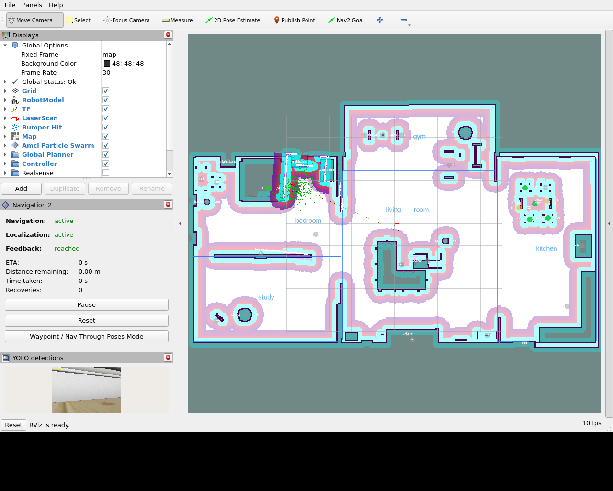

# Semantic Goal Navigation for Mobile Robots

ROS 2 Humble · Gazebo · Nav2 · Cartographer / AMCL · YOLOv8n · LLM command parsing (Ollama)

AIR 2026 Summer Training Program, Centre for Intelligent Robotics, IIIT Allahabad.
Arpit Awasthi (23010503012), B.Tech CSE (AI & DS), GHEC Bilaspur. Guide: Dr. Surya Prakash.

You type *"go to the sofa"*. The TurtleBot3 finds the sofa on its semantic map and drives there,
avoiding obstacles on the way. The semantic map is built by the robot itself: YOLOv8n spots objects
in the camera image, and the LiDAR (through TF2) tells where they are on the map.

---

## 1. Setup (once)

Ubuntu 22.04 with ROS 2 Humble installed. Put this folder at `~/semantic_goal_nav_ws`, then:

```bash
cd ~/semantic_goal_nav_ws
bash setup.sh          # apt packages (Gazebo, TurtleBot3, Nav2, Cartographer), Ultralytics, colcon build
```

Optional, for LLM mode (without it the robot uses keyword mode, which handles all the commands below):

```bash
curl -fsSL https://ollama.com/install.sh | sh
ollama pull gemma2:2b
```

The first run downloads `yolov8n.pt` (6 MB) automatically.

## 2. Run

**Terminal 1** starts everything: Gazebo house, robot, AMCL on the saved map, Nav2, the 4 semantic nodes and RViz.

```bash
source ~/semantic_goal_nav_ws/install/setup.bash
ros2 launch semantic_goal_nav semantic_goal_nav.launch.py
```

Wait until the log shows `AMCL is localised at the initial pose` and `model ready`, about 20–40 s.

**Terminal 2** is where you talk to the robot:

```bash
source ~/semantic_goal_nav_ws/install/setup.bash
ros2 run semantic_goal_nav chat
```

Try:

| You type | What happens |
|---|---|
| `go to the sofa` | drives to the couch (sofa → couch through the synonym table) |
| `take me to the kitchen` | drives into the kitchen |
| `go to the chair near the table` | picks the chair that is next to a dining table |
| `go to the farthest chair` / `go to the second chair` | ordered by distance from the robot |
| `go to the chair in the bedroom` | only chairs inside that room |
| `go to the bed and then go to the fridge` | two goals, one after the other |
| `how many chairs are in the kitchen` / `where are the chairs` | answers from the map |
| `what do you see` | lists the objects on the map, room by room |
| `stop` | cancels the current goal immediately |

A one-shot command also works: `ros2 run semantic_goal_nav chat "go to the bed"`.

### Launch options

| Option | Default | Meaning |
|---|---|---|
| `world_map:=old` | `house` | navigate on our earlier `apartment_map` with the team's rooms and objects instead of the clean house map (see "Our earlier map" below) |
| `slam:=true` | `false` | Cartographer builds the map live, instead of AMCL on the saved map |
| `use_known_objects:=false` | `true` | start with an empty semantic map; the robot only knows what its camera has seen |
| `llm_mode:=auto` | `keyword` | `keyword` = instant keyword matching; `auto` = LLM (Ollama) if it answers, else keywords; `llm` = LLM only |
| `ollama_model:=llama3.2:3b` | `gemma2:2b` | any model pulled in Ollama |
| `yolo_model:=/path/best.pt` | `yolov8n.pt` | your own trained weights |
| `gui:=false rviz:=false` | `true` | no Gazebo window / no RViz (faster on a slow laptop) |
| `x_pose:= y_pose:= yaw:=` | per map | where the robot starts in Gazebo; the matching initial pose is given to AMCL automatically |
| `load_saved_map:=false` | `true` | ignore objects detected in earlier runs (`~/.ros/semantic_map_<map>.json`) |

To see the camera with the YOLO boxes: the **YOLO detections** panel in RViz, or `ros2 run rqt_image_view rqt_image_view /yolo/annotated_image`.

Detection-only demo, where the map is built from what the camera sees:

```bash
ros2 launch semantic_goal_nav semantic_goal_nav.launch.py use_known_objects:=false load_saved_map:=false
# terminal 2:
ros2 run semantic_goal_nav chat "go to the kitchen and then go to the gym, then take me to the bedroom"
ros2 run semantic_goal_nav chat "what do you see"
ros2 run semantic_goal_nav chat "go to the bed"
```

### Our earlier map (`world_map:=old`)

`maps/apartment_map.*` is the map from our first runs. `config/rooms_old.yaml` and
`config/known_objects_old.yaml` hold the team's kitchen / dining room / bedroom and the 9 marked
objects. The launch lines the map up with the house: its frame is the house frame rotated by −97.4°
and shifted by (5.85, 3.65) m. That is what puts the robot at the right initial pose.

Tested in the simulation: **the robot cannot work on this map**. The map was drifted when it
was built:
- it has walls that are not in the house;
- it is missing the whole west half (bedroom and study);
- only about 30% of its walls match the real house.

In the test, the planner found no path even to a goal 0.7 m away, every room command timed out, and
AMCL ended up 10 m away from the real robot. That is why the default is the clean map
(`world_map:=house`). The old map stays in the package so you can try it and compare.

## 3. How it works

```
 2D LiDAR ──/scan──► ① Cartographer SLAM / AMCL ──/map, map→odom TF──► ⑤ Nav2 Goal Sender ──► Nav2 ──/cmd_vel──► TurtleBot3
 Odometry ──/odom──┘                                                       ▲ /semantic_goal
 RGB camera ──/camera/image_raw──► ② YOLOv8n Detector ──/detected_objects──► ③ Semantic Map Manager
 LiDAR + TF2 (+ depth camera if present) ───────────────────────────────────┘        │ /semantic_map
 User text ──/user_command──► ④ LLM Command Node ◄─────────────────────────────────────┘
```

| # | Node | What it does |
|---|---|---|
| ① | Cartographer (`slam:=true`) or map_server + AMCL | map + robot pose in the map |
| ② | `yolo_detector` | YOLOv8n on the camera, about 4 frames/s; publishes boxes (JSON) and an annotated image |
| ③ | `semantic_map_manager` | turns each box into a map position and keeps label → (x, y), room by room |
| ④ | `llm_command` | sentence → plan (LLM JSON or keyword matching) → map lookup → goal pose |
| ⑤ | `nav2_goal_sender` | sends the goal to Nav2, reports progress, recovers and retries on failure |

**From a box to a map position (③).** The TurtleBot3 Waffle Pi has an RGB camera but no depth
camera. So every LiDAR hit is transformed through TF2 into the camera's optical frame and projected
into the image with the camera intrinsics (`/camera/camera_info`). The hits whose pixel column falls
inside the box are the object. The nearest of them is its front surface, because whatever is behind
it is further away. That point is transformed to the map frame at the image timestamp. This replaces
the fixed camera–LiDAR offset that put objects 0.5–1.5 m off. If a depth camera is present, set
`depth_topic` and the median depth inside the box is used instead.

Checks before a sighting is used:
- confidence ≥ 0.45
- within 5 m
- clear line of sight on the occupancy grid, so nothing is mapped through a wall
- seen at least 3 times before the robot will drive to it

Sightings of the same object are merged with a running mean, so the position settles.

**From a sentence to a goal (④).**
- **Keyword mode** matches object and room words, including synonyms like sofa → couch,
  fridge → refrigerator and almirah → wardrobe. It also understands qualifiers: *near the X*,
  *in the kitchen*, *farthest*, *second*, *avoid the person*, *how many*, *and then*.
- **LLM mode** sends a structured prompt to the local Ollama model. The prompt lists the valid
  classes, rooms and the objects on the map. The JSON reply is validated, so the LLM cannot invent
  an object or a room. Anything unusable falls back to keyword mode.

The goal is not the object's own centre, because the object is an obstacle. It is a point 0.6 m in
front of the object, facing it. If the nearest matching object is unreachable, the next one is tried.

**Reaching the goal (⑤).**
- A goal that lands in or next to an obstacle is moved to the nearest free floor.
- On an aborted goal, the node backs up 15 cm, rotates 90° through the Nav2 behaviour servers and
  tries again.
- Nav2 uses the NavFn global planner and the DWB controller, with inflation radius 0.55 m and goal
  tolerance 0.25 m.



*RViz after "go to the bed". It shows the saved map with the costmaps, the room outlines and
names, the semantic map markers (green = detected and confirmed, grey = known furniture), the
robot in the bedroom, and the YOLO camera panel.*

### What was tested

Everything ran in a full simulation with the Gazebo window open: house + Waffle Pi + AMCL + Nav2 +
the 4 nodes. "Localisation error" is the gap between AMCL's pose and the robot's true position in
Gazebo.

**Clean map (default), 11 of 11 commands reached their goal:**

| Command | Result | Localisation error |
|---|---|---|
| go to the chair near the table | arrived (stopped beside the chair, not under the table) | 0.08 m |
| take me to the bedroom / study / gym / living room / kitchen | arrived | 0.03–0.29 m |
| go to the bed / tv / dumbbell / sofa / fridge | arrived | 0.01–0.26 m |

**Also tested:**
- Detection-only map (`use_known_objects:=false`):
  - the tour `kitchen → gym → bedroom` completed;
  - the chair, dining table, refrigerator and bed were detected and placed;
  - `go to the bed` drove to the detected bed;
  - `stop` halted the robot mid-way;
  - "what do you see" and "how many chairs" answered correctly.
- Our earlier map (`world_map:=old`): 0 of 3 room commands succeeded, and AMCL lost the robot by
  10 m (see above).
- The 36 unit tests pass.

**Not run here:**
- The LLM path was exercised with a stand-in server that returns LLM-style JSON, with chatter,
  synonyms and capitals. A real Ollama model was not available on the test machine.
- `slam:=true` (Cartographer) could not be run in that environment. It uses the standard
  TurtleBot3 Cartographer setup from the apt packages in `setup.sh`.

## 4. Files

```
semantic_goal_nav_ws/
├── setup.sh                         one-time install + build
├── README.md
└── src/
    ├── aws-robomaker-small-house-world/   the Gazebo house (AWS RoboMaker, unchanged)
    └── semantic_goal_nav/
        ├── launch/semantic_goal_nav.launch.py  everything, one launch file
        ├── launch/sim.launch.py           Gazebo house + TurtleBot3 Waffle Pi only
        ├── semantic_goal_nav/
        │   ├── yolo_detector.py           ② YOLOv8n node
        │   ├── semantic_map_manager.py    ③ semantic map node
        │   ├── llm_command.py             ④ LLM / keyword command node
        │   ├── nav2_goal_sender.py        ⑤ Nav2 action client + recovery + initial pose
        │   ├── chat.py                    terminal for typing commands
        │   ├── command_parser.py          keyword parser, LLM prompt, JSON validation
        │   ├── semantic_map.py            object store, rooms, queries, save/load
        │   ├── projection.py              box → 3D point (LiDAR or depth)
        │   ├── geometry.py                transforms, polygons, occupancy grid, approach point
        │   ├── vocab.py                   classes, synonyms, rooms
        │   └── llm_client.py              Ollama HTTP client
        ├── config/
        │   ├── nav2_params.yaml           Nav2 (NavFn + DWB, costmaps, AMCL, behaviours)
        │   ├── cartographer.lua           2D SLAM for the 360° LiDAR
        │   ├── semantic_goal_nav.yaml          parameters of the 4 nodes
        │   ├── map_profiles.yaml          which map / rooms / objects for world_map:=house | old
        │   ├── rooms.yaml                 room polygons + waypoints (clean map)
        │   ├── known_objects.yaml         furniture positions in the Gazebo house
        │   ├── rooms_old.yaml             the team's rooms on our earlier map
        │   └── known_objects_old.yaml     the team's marked objects on our earlier map
        ├── maps/small_house.{yaml,pgm}    clean occupancy grid of the house (default)
        ├── maps/apartment_map.{yaml,pgm}  our earlier map (world_map:=old)
        ├── rviz/semantic_goal_nav.rviz         map, robot, plan, semantic markers, YOLO image
        ├── tools/                         make_known_objects.py, strip_robot_from_world.py
        └── test/test_core.py              36 unit tests (no ROS needed)
```

Unit tests: `cd src/semantic_goal_nav && python3 -m pytest test -q`

## 5. Troubleshooting

| Problem | Fix |
|---|---|
| Gazebo window crashes (`gzclient ... SIGABRT`) | The window now opens only after the house and robot have loaded. If it still crashes on your graphics card, run with `gui:=false`: the simulation keeps running and you watch it in RViz |
| Nav2 prints `odom`/`base_link` "Timed out waiting for transform" for a long time | The robot is not in Gazebo yet. The first load of the house can take 1–3 minutes, and the robot is spawned once Gazebo answers (it waits up to 5 min). Wait for `robot spawned` in the log |
| Robot does not move, log says `AMCL did not take the initial pose` | In RViz, click **2D Pose Estimate** where the robot is |
| `I haven't seen a chair yet` | Drive around (`take me to the kitchen`) so the camera sees it, or run with `use_known_objects:=true` |
| `entity [waffle_pi] already exists` after saving a world in Gazebo | `python3 src/semantic_goal_nav/tools/strip_robot_from_world.py your.world` |
| Gazebo very slow (Real Time Factor below 0.5), RViz "not responding" | The laptop is running Gazebo's 3D window, RViz, YOLO and Nav2 at once on the CPU. Keep only one viewer: `gui:=false` (watch in RViz) or `rviz:=false` (watch in Gazebo). Close Chrome tabs. YOLO runs 2 times per second (`max_rate_hz` in `config/semantic_goal_nav.yaml`) |
| `transformPoseInTargetFrame ... extrapolation into the past` | Fixed: goals are now held until the robot is localised and use the latest transform. If it still appears, the simulation is too slow; see the row above |
| `Ollama ... not reachable` | `ollama serve`, `ollama pull gemma2:2b`; keyword mode keeps working meanwhile |
| Old objects keep coming back | `rm ~/.ros/semantic_map_*.json` or `load_saved_map:=false` |
| numpy / cv2 import errors | `pip3 install --user "numpy<2"` |
